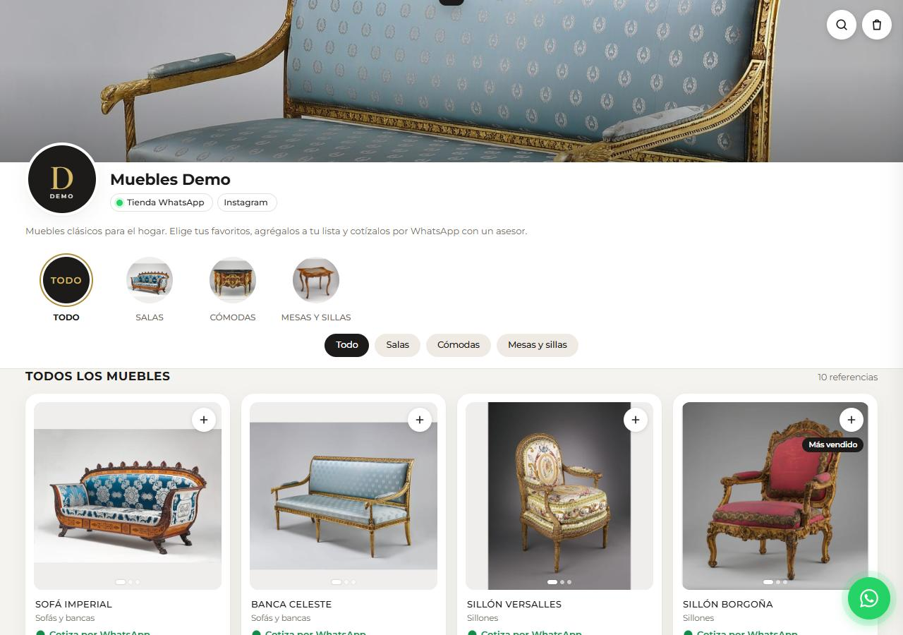
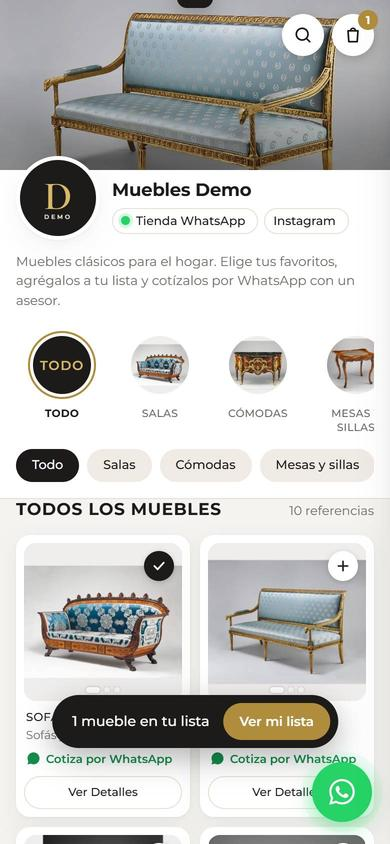

# Furniture Shop Demo

**Live demo: https://cuajada69.github.io/furniture-shop-demo/**

A static, mobile-first storefront for a small furniture store that sells through WhatsApp. Customers browse collections, filter and search, add pieces to a quote list, and send the whole list to the seller as a pre-filled WhatsApp message. No backend, no database, no payment integration: it can be hosted for free on GitHub Pages.

The store data is fictional ("Muebles Demo") and the photos are public domain. The same template was built for a real client's catalog.

<p align="center">
  
  
</p>

## Features

- Collections with image shortcuts, filter chips and accent-insensitive search
- Product detail sheet with photo gallery and zoom
- **Quote list** persisted in `localStorage`; the customer adds name and city and sends it as one WhatsApp message
- Prices are optional: products without a price show "Cotiza por WhatsApp" (many small stores don't publish prices)
- Everything is generated from one `shop.json` file

## Build

```bash
npm install
npm run build   # writes the site to docs/ (served by GitHub Pages)
```

`src/build.mjs` resizes photos with `sharp` (square thumbnails that never crop the product, plus full-size images), copies self-hosted fonts, derives each product's filter tags from regex patterns in `shop.json`, and injects the data into `src/template.html`. The JSON is embedded with `<` escaped so product text can never break out of the `<script>` tag, and the build fails if any template placeholder is left unreplaced.

## Configuration

```json
{
  "brand": "Muebles Demo",
  "whatsapp": "573000000000",
  "collections": [
    { "id": "salas", "name": "Salas", "chips": [["Sillones", "sill"], ["Tapiz floral", "floral|bordad"]] }
  ],
  "products": [
    { "id": "sillon-borgona", "name": "Sillón Borgoña", "collection": "salas", "description": "...", "photos": 3, "badge": "Más vendido" }
  ],
  "prices": { "sillon-borgona": 1850000 }
}
```

Photos are read from `photos/<id>-<n>.jpg`.

## Credits

Demo photos: The Metropolitan Museum of Art Open Access via Wikimedia Commons, CC0. See [photos/CREDITS.md](photos/CREDITS.md).

## License

MIT
